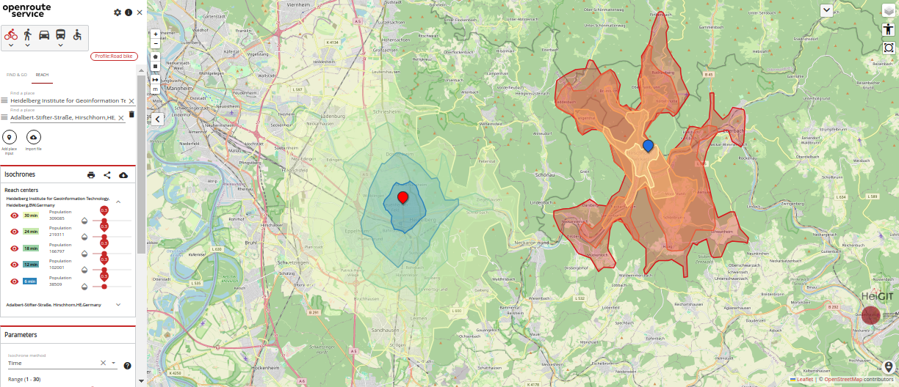

# geovis-route

[](https://hub.docker.com/r/heigit/geovis-route/tags)
[](https://hub.docker.com/r/heigit/geovis-route/tags)
[](https://sonarcloud.io/summary/new_code?id=GIScience_geovis-route)
[](https://sonarcloud.io/summary/new_code?id=GIScience_geovis-route)
[](https://sonarcloud.io/summary/new_code?id=GIScience_geovis-route)
[](https://sonarcloud.io/summary/new_code?id=GIScience_geovis-route)
[](https://github.com/GIScience/geovis-route/releases/latest)
[](LICENSE)

geovis-route is a highly customizable, performant routing service written in Java. 
It uses a [forked and edited version of graphhopper 4.0](https://github.com/GIScience/graphhopper) 
and provides global spatial services by consuming user-generated and collaboratively collected free geographic data directly from [OpenStreetMap](http://www.openstreetmap.org): 

* [Directions Service](https://giscience.github.io/geovis-route/api-reference/endpoints/directions/): Get directions for different modes of transport
* [Isochrones Service](https://giscience.github.io/geovis-route/api-reference/endpoints/isochrones/): Obtain areas of reachability from given locations
* [Matrix Service](https://giscience.github.io/geovis-route/api-reference/endpoints/matrix/): Obtain one-to-many, many-to-one and many-to-many matrices for time and distance
* [Snapping Service](https://giscience.github.io/geovis-route/api-reference/endpoints/snapping/): Snap coordinates to the road network
* [Export Service](https://giscience.github.io/geovis-route/api-reference/endpoints/export/): Export the base graph for different modes of transport
* [Health Endpoint](https://giscience.github.io/geovis-route/api-reference/endpoints/health/)¹: Get information on the health of the running geovis-route instance
* [Status Endpoint](https://giscience.github.io/geovis-route/api-reference/endpoints/status/)¹: Get information on the status of the geovis-route instance

¹) **Health and Status Endpoint are not available in our public geovis-route API aka "live API"!** 
You can use them by running your own instance of geovis-route.

And to avoid any misunderstandings, it should also be mentioned at this point that our live API provides several other endpoints 
that are **not part of the geovis-route software/repository**:

* [openpoiservice](https://github.com/GIScience/openpoiservice): A stand-alone service from HeiGIT that returns points of interest in the area surrounding a geometry
* [openelevationservice](https://github.com/GIScience/openelevationservice): A stand-alone service from HeiGIT that returns the elevation for point or line geometries
* [Pelias](https://www.pelias.io): A (reverse) geocoder hosted by HeiGIT that resolves geographic coordinates to addresses and vice versa
* [VROOM](https://github.com/VROOM-Project/vroom): The Vehicle Routing Open-source Optimization Machine hosted by HeiGIT 

To play around with geovis-route you may use our [demonstration server](https://maps.geovis-route.org) which comes with both the backend and a [frontend](https://github.com/GIScience/ors-map-client). 
Or simply [sign up](https://geovis-route.org/dev/#/signup) for an API key and fire your requests against the API directly.
You can also do this in our [API Playground](https://geovis-route.org/dev/#/api-docs) - take a look at the [API Reference](https://giscience.github.io/geovis-route/api-reference/) to get more information.




## Installation

You can easily [run geovis-route](https://giscience.github.io/geovis-route/run-instance/) yourself! 

**tl;dr:** We suggest [using docker](https://giscience.github.io/geovis-route/run-instance/running-with-docker) to install and launch geovis-route. 
In short, a machine with a working [docker installation](https://www.digitalocean.com/community/tutorial_collections/how-to-install-and-use-docker) will get everything done for you. 

Change to the directory where you want to install your local geovis-route and first create some directories, where geovis-route will persist its data:
```shell
mkdir -p ors-docker/config ors-docker/elevation_cache ors-docker/graphs ors-docker/files ors-docker/logs
```

Only use nightly (main branch) if you know what you do. 
We recommend running docker compose with the latest release version. 
Get the docker compose file for a release, e.g. v8.0.0: 
```shell
wget https://github.com/GIScience/geovis-route/releases/download/v8.0.0/docker-compose.yml
```

Start geovis-route in the background:
```shell
docker compose up -d
```

This will pull the geovis-route docker image of the selected version and start it up using an example setup
and the provided test OSM file for Heidelberg/Germany and surrounding area.

To see the container's logs, run:
```shell
docker compose logs 
```

Stop the container with:
```shell
docker compose down
```

## Usage

The above mentioned endpoints will be available on port 8080:

- `http://localhost:8080/ors/v2/directions`
- `http://localhost:8080/ors/v2/isochrones`
- `http://localhost:8080/ors/v2/matrix`
- `http://localhost:8080/ors/v2/snap`
- `http://localhost:8080/ors/v2/export`
- `http://localhost:8080/ors/v2/health`
- `http://localhost:8080/ors/v2/status`

You can find more information in the endpoint documentation pages linked above.

On the [API Reference](https://giscience.github.io/geovis-route/api-reference/) there is also a description
how you can use the Swagger-UI and the API Playground for local instances of geovis-route.


## Changelog/latest changes

[geovis-route CHANGELOG](https://github.com/GIScience/geovis-route/blob/main/CHANGELOG.md)


## Contribute

We appreciate any kind of contribution - bug reports, new feature suggestion or improving our translations are greatly appreciated. Feel free to create an [issue](https://github.com/GIScience/geovis-route/issues) and label it accordingly. If your issue regards the geovis-route web-app please use the [corresponding repository](https://github.com/GIScience/ors-map-client/issues).

If you want to contribute your improvements, please follow the steps outlined in [our CONTRIBUTION guidelines](./CONTRIBUTE.md)

The [sourcespy dashboard](https://sourcespy.com/github/gisciencegeovis-route/) provides a high level overview of the repository including technology summary, module dependencies and other components of the system.


## Questions

For questions please use our [community forum](https://ask.geovis-route.org).


## Translations

If you notice anything wrong with translations, or you want to add a new language to the geovis-route instructions, we have some instructions in our [backend documentation](https://GIScience.github.io/geovis-route/contributing/contributing-translations) about how you can submit an update. You can also look over at our [maps client GitHub](https://github.com/GIScience/ors-map-client/#add-language) if you want to contribute the language to there as well (adding or editing the language in the geovis-route GitHub repo only affects the instructions - any new language also needs adding to the client).
