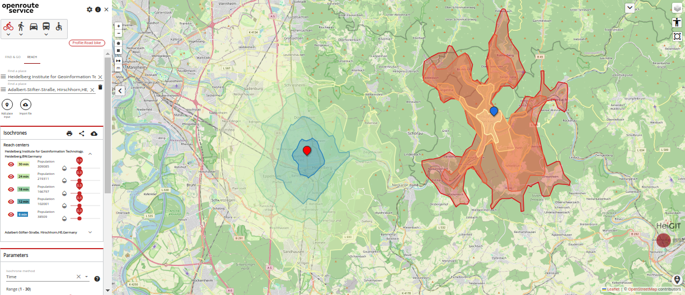

# geovis-route

[](https://hub.docker.com/r/heigit/geovis-route/tags)
[](https://hub.docker.com/r/heigit/geovis-route/tags)
[](https://sonarcloud.io/summary/new_code?id=GIScience_geovis-route)
[](https://sonarcloud.io/summary/new_code?id=GIScience_geovis-route)
[](https://sonarcloud.io/summary/new_code?id=GIScience_geovis-route)
[](https://sonarcloud.io/summary/new_code?id=GIScience_geovis-route)
[](https://github.com/GIScience/geovis-route/releases/latest)
[](LICENSE)

geovis-route 是一个高度可定制、性能出色的路径规划服务，使用 Java 编写。
它使用[经过分叉并修改的 graphhopper 4.0 版本](https://github.com/GIScience/graphhopper)，
并直接使用 [OpenStreetMap](http://www.openstreetmap.org) 上由用户生成和协作收集的免费地理数据提供全球空间服务：

* [路径规划服务](https://giscience.github.io/geovis-route/api-reference/endpoints/directions/)：获取不同交通方式的路线指引
* [等时圈服务](https://giscience.github.io/geovis-route/api-reference/endpoints/isochrones/)：获取从给定位置出发的可达区域
* [矩阵服务](https://giscience.github.io/geovis-route/api-reference/endpoints/matrix/)：获取时间与距离的一对多、多对一及多对多矩阵
* [吸附服务](https://giscience.github.io/geovis-route/api-reference/endpoints/snapping/)：将坐标吸附到路网
* [导出服务](https://giscience.github.io/geovis-route/api-reference/endpoints/export/)：导出不同交通方式的基础图
* [健康检查端点](https://giscience.github.io/geovis-route/api-reference/endpoints/health/)¹：获取正在运行的 geovis-route 实例的健康状况信息
* [状态端点](https://giscience.github.io/geovis-route/api-reference/endpoints/status/)¹：获取 geovis-route 实例的状态信息

¹) **健康检查端点与状态端点在我们公开的 geovis-route API（即 "live API"）中不可用！**
你可以通过运行自己的 geovis-route 实例来使用它们。

同时，为避免任何误解，这里还需要说明：我们的 live API 提供了一些其他端点，
它们**并不属于 geovis-route 软件/仓库的一部分**：

* [openpoiservice](https://github.com/GIScience/openpoiservice)：HeiGIT 提供的一个独立服务，用于返回几何体周边区域内的兴趣点
* [openelevationservice](https://github.com/GIScience/openelevationservice)：HeiGIT 提供的一个独立服务，用于返回点或线几何体的高程
* [Pelias](https://www.pelias.io)：由 HeiGIT 托管的（反向）地理编码器，可将地理坐标解析为地址，反之亦然
* [VROOM](https://github.com/VROOM-Project/vroom)：由 HeiGIT 托管的车辆路径规划开源优化引擎（Vehicle Routing Open-source Optimization Machine）

想试用 geovis-route，可以使用我们的[演示服务器](https://maps.geovis-route.org)，它同时包含后端和一个[前端](https://github.com/GIScience/ors-map-client)。
或者直接[注册](https://geovis-route.org/dev/#/signup)获取 API key，然后直接向 API 发送请求。
你也可以在我们的 [API Playground](https://geovis-route.org/dev/#/api-docs) 中完成这些操作——查看 [API Reference](https://giscience.github.io/geovis-route/api-reference/) 了解更多信息。




## 安装

你可以轻松地[自行运行 geovis-route](https://giscience.github.io/geovis-route/run-instance/)！

**简而言之：** 我们建议[使用 docker](https://giscience.github.io/geovis-route/run-instance/running-with-docker) 来安装并启动 geovis-route。
简单来说，一台已安装好 [docker](https://www.digitalocean.com/community/tutorial_collections/how-to-install-and-use-docker) 的机器就能为你搞定一切。

切换到你想安装本地 geovis-route 的目录，先创建一些供 geovis-route 持久化数据的目录：
```shell
mkdir -p ors-docker/config ors-docker/elevation_cache ors-docker/graphs ors-docker/files ors-docker/logs
```

只有在你清楚自己在做什么的情况下才使用 nightly（main 分支）。
我们建议使用最新发布版本运行 docker compose。
获取某个发布版本（例如 v8.0.0）的 docker compose 文件：
```shell
wget https://github.com/GIScience/geovis-route/releases/download/v8.0.0/docker-compose.yml
```

在后台启动 geovis-route：
```shell
docker compose up -d
```

这将拉取所选版本的 geovis-route docker 镜像，并使用示例配置及提供的 Heidelberg（德国）及周边地区的测试 OSM 文件启动它。

查看容器日志，请运行：
```shell
docker compose logs 
```

停止容器：
```shell
docker compose down
```

## 使用

上述端点将在 8080 端口上可用：

- `http://localhost:8080/ors/v2/directions`
- `http://localhost:8080/ors/v2/isochrones`
- `http://localhost:8080/ors/v2/matrix`
- `http://localhost:8080/ors/v2/snap`
- `http://localhost:8080/ors/v2/export`
- `http://localhost:8080/ors/v2/health`
- `http://localhost:8080/ors/v2/status`

更多信息可在上面链接的端点文档页面中找到。

在 [API Reference](https://giscience.github.io/geovis-route/api-reference/) 中还有关于
如何在 geovis-route 本地实例上使用 Swagger-UI 和 API Playground 的说明。


## 变更日志/最新变更

[geovis-route CHANGELOG](https://github.com/GIScience/geovis-route/blob/main/CHANGELOG.md)


## 参与贡献

我们欢迎任何形式的贡献——缺陷报告、新功能建议或改进我们的翻译都非常感谢。欢迎创建一个 [issue](https://github.com/GIScience/geovis-route/issues) 并打上相应标签。如果你的 issue 与 geovis-route web 应用有关，请使用[相应的仓库](https://github.com/GIScience/ors-map-client/issues)。

如果你想贡献你的改进，请遵循[我们的贡献指南](./CONTRIBUTE.zh.md)中列出的步骤。

[sourcespy dashboard](https://sourcespy.com/github/gisciencegeovis-route/) 提供了该仓库的高层次概览，包括技术摘要、模块依赖以及系统的其他组成部分。


## 问题咨询

如有疑问，请使用我们的[社区论坛](https://ask.geovis-route.org)。


## 翻译

如果你发现翻译有任何问题，或想为 geovis-route 的指引添加新语言，我们的[后端文档](https://GIScience.github.io/geovis-route/contributing/contributing-translations)中有关于如何提交更新的说明。如果你也想向[地图客户端 GitHub](https://github.com/GIScience/ors-map-client/#add-language) 贡献该语言，也可以去看看那里（在 geovis-route GitHub 仓库中添加或编辑语言只会影响指引——任何新语言还需要在客户端中添加）。
