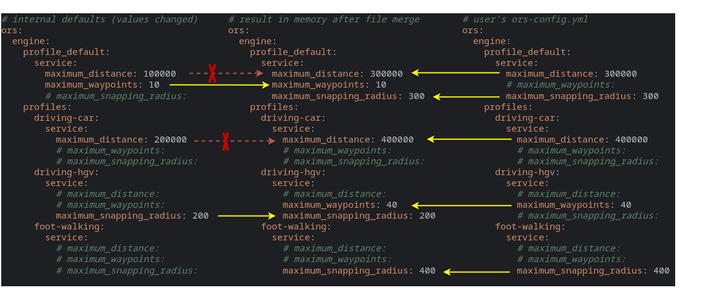
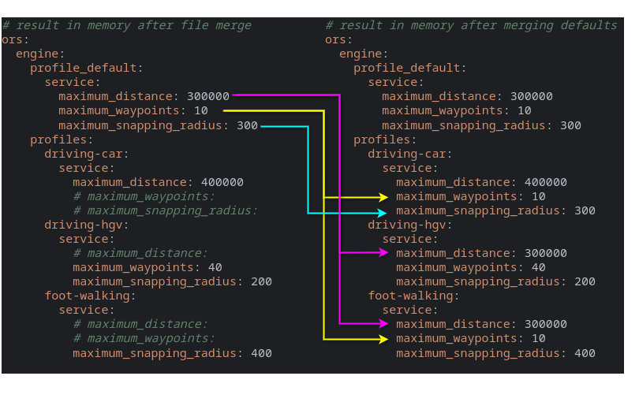

# 如何配置 openrouteservice

在本章中，我们将处理配置主题的不同维度：

* 相同配置属性的[不同表示法](#different-notations)
* [内部默认值](#internal-defaults)：它们在哪里定义，如何查看内部默认值
* [设置单个值的不同方式](#different-ways-to-set-individual-values)
    * 将名为 `gr-config.yml` 的[默认配置文件](#default-config-file)放在
      openrouteservice 查找它的某个目录中
    * 或者指定一个[自定义配置文件](#custom-config-file)
    * 在 shell 中或环境变量文件中使用[环境变量](#environment-variables)覆盖属性
    * 使用 [JVM 程序参数](#jvm-program-arguments)覆盖属性
    * 使用 [Spring 运行参数](#spring-run-arguments)覆盖属性
    * [**这些不同属性来源的优先级**](#priority-of-these-different-property-sources)
* [Docker 场景](#docker-scenarios)
* 在 `ors.engine.profile_default` 中[为所有路由配置定义默认值](#defining-defaults-for-all-routing-profiles)
* [从图目录加载的图构建属性](#graph-build-properties-loaded-from-graph-directories)

## 不同表示法

openrouteservice 的配置可以用不同的表示法来指定。
在哪种场景下最好使用哪种格式，记录在
[JAR](/run-instance/running-jar.md)、[WAR](/run-instance/running-war.md)
和 [Docker](/run-instance/running-with-docker.md) 的配置文档中。

* `.yml` 是自版本 8 起的默认配置格式。你可以找到一个包含所有
  可用配置选项的[示例配置文件](https://github.com/GIScience/openrouteservice/blob/main/gr-config.yml)。其中只激活了最小的属性集合，其他所有选项都被注释掉了。
* 用于 Docker 配置的 `.env` 文件。也有一个
  [示例 env 文件](https://github.com/GIScience/openrouteservice/blob/main/gr-config.env)，你可以下载
  并定制。
* `.json` 配置文件：过去 openrouteservice 是[通过 JSON 文件](json.zh.md)配置的。该配置方式
  已被**弃用**，并在 ORS 版本 9 中移除。因此，我们强烈建议你不要再使用它。如果你
  有旧的 JSON 配置，请考虑
  [迁移到新配置](https://github.com/GIScience/gr-config-migration#usage)。

上述所有配置文件都可以包含相同的逻辑应用属性。

例如，属性 `ors.engine.profiles.car.enabled` 在

`*.yml` 中

```yaml
ors:
    engine:
        profiles:
            driving-car:
                enabled: true
```

在 `*.env` 中如下所示之一

```shell
ors.engine.profiles.driving-car.enabled=true
ORS_ENGINE_PROFILES_DRIVING_CAR_ENABLED=true
```

作为 Spring 或 JVM 运行参数

```shell 
ors.engine.profiles.driving-car.enabled=true
```

::: tip
在本文档中，我们大多使用点号表示法来命名配置属性，
因为它比带换行和缩进的 YAML 风格更紧凑，
并且比大写加下划线的环境变量风格更易读。
:::

## 内部默认值

openrouteservice 具有合理的默认值，可以用最小配置启动，
参见[要配置什么](what-to-configure#minimal-configuration)。
内部默认值定义在文件
[
`ors-api/src/main/resources/application.yml`](https://github.com/GIScience/openrouteservice/blob/main/ors-api/src/main/resources/application.yml) 中。

除了大多数配置属性的默认值之外，
还有针对所有支持模态的**默认路由配置**，每个都有合理的默认值。
这些默认配置以其标志编码器（flag encoder）的名称命名。
更多详细信息请参见[配置](engine/profiles/index.zh.md)。

openrouteservice 的[发布版本](https://github.com/GIScience/openrouteservice/releases)还包含可下载的
示例 `gr-config.yml` 和 `gr-config.env` 文件作为发布资产，
其中所有属性及其默认值都以注释行的形式包含在内。

### 配置默认值输出

自版本 9.0.0 起，openrouteservice 提供了在启动时输出默认配置的选项。
这对于调试目的很有用，或者用于生成包含所有默认值的自定义配置文件模板。
要启用此功能，请在启动 openrouteservice 之前将参数 `ors.engine.config_output` 设置为目标文件名。
输出将写入该名称的文件，如果未提供扩展名，则会自动添加 `.yml`。

```yaml
ors:
    engine:
        config_output: gr-config-example.yml
```

设置此选项的其他方式同样适用上文所述的 Spring 运行时参数、Java VM 运行时参数或环境变量。
以下所有命令都可以达到相同的效果：

* Spring 运行时参数：

```shell 
java -jar ors.jar --ors.engine.config_output=gr-config-example.yml
```

* JVM 运行时参数：

```shell 
java -jar -Dors.engine.config_output=gr-config-example.yml ors.jar 
```

* 环境变量：
    ```shell 
    export ors.engine.config_output=gr-config-example.yml
    java -jar ors.jar 
    ```
  或
    ```shell 
    export ORS_ENGINE_CONFIG_OUTPUT=gr-config-example.yml
    java -jar ors.jar 
    ```

::: warning 提示
导出的文件包含的是内部默认值，
而**不是**所有已使用配置来源的合并结果！
:::

## 设置单个值的不同方式

自定义配置属性可以通过配置文件、环境变量和启动参数来设置：

### 默认配置文件

如果未指定配置位置（参见[下文](#custom-config-file)），
openrouteservice 会按以下顺序在下列位置查找名为 `gr-config.yml` 的配置文件。
第一个存在的文件（且仅此文件）将作为配置来源。

| 路径                                        | 描述                    |
|:--------------------------------------------|:-------------------------------|
| `./gr-config.yml`                          | 当前工作目录      |
| `~/.config/openrouteservice/gr-config.yml` | 用户配置目录   |
| `/etc/openrouteservice/gr-config.yml`      | 全局配置目录 |

当 openrouteservice 在容器中运行时，这些目录是在容器内部检查的，
容器外部的文件可以被挂载进来。

::: tip
在应用程序启动时，openrouteservice 会记录加载了哪个配置文件。
如果在容器内运行，打印的路径是内部路径。
:::

### 自定义配置文件

openrouteservice 也可以使用 `gr-config.yml` 之外的 yml 文件作为配置来源。
有两种方式向 openrouteservice 提供自定义配置文件的位置：

1. 程序参数
      ```shell 
      java -jar ors.jar /path/to/my-gr-config.yml
      ```
2. 环境变量 `GR_CONFIG_LOCATION`
      ```shell 
      export GR_CONFIG_LOCATION=/path/to/my-gr-config.yml
      java -jar ors.jar
      ```

如果两者都指定，以程序参数为准。
使用自定义配置文件时，`gr-config.yml` 文件将被忽略。

### 环境变量

所有或单个配置参数都可以作为环境变量来覆盖/定义。

```shell 
export ors.engine.profile_default.build.source_file=./osm_file.pbf 
export ors.engine.profiles.driving-car.enabled=true
java -jar ors.jar 
```

这在你希望将 openrouteservice 运行在诸如 [docker](/run-instance/running-with-docker.md) 之类的容器中时特别有用。

每个属性也对应一个环境变量名，采用*大写字母*并用*下划线*替换
*点号*，例如

- `ORS_ENGINE_PROFILE_DEFAULT_BUILD_SOURCE_FILE` 替换 `ors.engine.profile_default.build.source_file`
- `ORS_ENGINE_PROFILES_CAR_ENABLED` 替换 `ors.engine.profiles.car.enabled`

因此，以下命令与上面最后一个示例等效：

```shell
  export ORS_ENGINE_PROFILE_DEFAULT_BUILD_SOURCE_FILE=./osm_file.pbf
  export ORS_ENGINE_PROFILES_CAR_ENABLED=true
  java -jar ors.jar
```

请注意，定义环境变量的方式有多种，
例如
在 [docker compose 文件](/run-instance/running-with-docker.md#set-openrouteservice-properties-in-docker-compose-yml)中
或
[env 文件](/run-instance/running-with-docker.md#set-openrouteservice-properties-in-an-environment-file)中
或在 [tomcat 配置](/run-instance/running-war.md#configure)的 `setenv.sh` 文件中。

### JVM 程序参数

所有或单个配置参数都可以作为 JVM 运行参数来覆盖/定义：

```shell 
java -jar -Dors.engine.profile_default.build.source_file=./osm_file.pbf -Dors.engine.profiles.driving-car.enabled=true ors.jar 
```

### Spring 运行参数

所有或单个配置参数都可以作为 Spring 运行参数来覆盖/定义：

```shell 
java -jar ors.jar --ors.engine.profile_default.build.source_file=./osm_file.pbf --ors.engine.profiles.driving-car.enabled=true
```

### 这些不同属性来源的优先级

如果属性在多个配置来源中设置，
优先级如下。1（最高优先级）到 5（最低）：

1. Spring 运行参数覆盖
2. JVM 程序参数覆盖
3. 环境变量覆盖
4. 所使用的单个配置文件中的属性覆盖
5. 内部默认值

下图说明了 config yml 如何覆盖部分内部默认值。
合并结果显示在中间。
红线是两侧都定义了属性的示例——用户配置优先。
注释行（绿色）只是为了更好的可读性。



## Docker 场景

在容器中运行的 openrouteservice 实例与本部分所述的工作方式相同。
不同之处在于，openrouteservice 的环境是一个 docker 容器，
它具有单独的文件系统（不同的路径）和独立的环境变量。
配置文件的查找始终与内部环境相关，
在 YAML 配置中配置路径，或者
在参数 `ors_config_location` 中指定配置文件时，必须注意这一点。

与“普通”配置一样，所有配置属性都可以作为环境变量设置。
与直接运行在宿主机系统上的应用程序相比，
这是 Docker 容器中配置应用程序更常见的方式，
因为在 docker 容器中有一个全新且独立的环境。

[使用 Docker 运行](/run-instance/running-with-docker.md#configure)详细说明了
在 docker 场景中如何配置 openrouteservice。

## 为所有路由配置定义默认值

除了不同配置来源的覆盖机制之外，
还有一种方式可以为所有（已启用的）路由配置定义默认值：

`ors.engine.profile_default` 中嵌套的结构与
`ors.engine.profiles` 中每个路由配置的结构完全相同。
每个特定的路由配置都会继承 `profile_default` 中的默认值，并且可以覆盖或添加单个属性。

需要理解的重要一点是，`ors.engine.profile_default` 和 `ors.engine.profiles` 本身就是配置
属性，
与配置属性层次结构中的所有其他属性一样，它们首先会从所有
配置来源进行合并。
这些属性的最终合并结果是配置默认值内部逻辑的基础：


一个副作用是，在内部默认值中定义的特定配置的属性，
无法被用户 `profile_default` 中的属性覆盖！
在上面的示例中，用户定义了 `ors.engine.profile_default.maximum_snapping_radius: 300`，
但 profile foot-walking 对于该属性有一个内部默认值 `400`。
特定配置的内部值优先于用户的 `profile_default`：



## 从图目录加载的图构建属性

在 `ors.engine.profiles.<PROFILE-NAME>.build`（以及 `ors.engine.profile_default.build`）中配置的配置属性
用于_构建_图。
当计算图时，openrouteservice 会将这些构建属性存储在文件 `graphs/<profile>/graph_build_info.yml` 中。

当 openrouteservice _加载_现有图而不是构建它时，
持久化的构建参数会再次从该文件中加载，
受影响的配置在本地的构建参数将被覆盖。

因此，绝不能编辑文件 `graph_build_info.yml`！
该文件的内容也会被
([Graph Repo Client](/technical-details/graph-repo-client/index.md))用于仓库查找。
