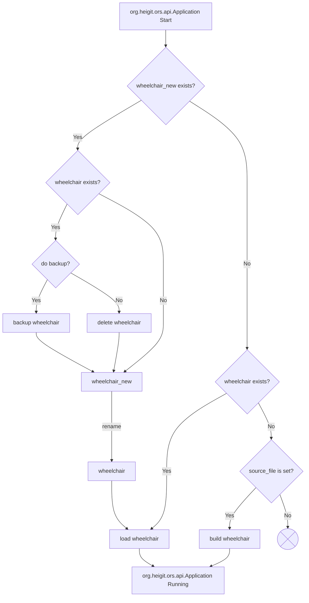

# 图仓库客户端

::: warning
图管理功能处于 beta 测试阶段，尚未向更广泛的公众开放。

如果你有兴趣测试图管理功能，
请在我们的[用户论坛](https://ask.openrouteservice.org/c/ors/5)中联系我们，
或发送电子邮件至 [support@smartmobility.heigit.org](mailto:support@smartmobility.heigit.org)。
:::

[//]: # (TODO: Can we come up with a consistent way to talk about it? "graph management" vs "graph repo client")

自 v9 起，openrouteservice 内置了图仓库客户端。
这使得下载并使用在其他地方构建的图、而不是在本地构建它们成为可能。
当仅使用来自仓库的图，并且
将 [ors.engine.graphs_data_acces](/run-instance/configuration/engine/index.zh.md#orsengine) 配置为 `MMAP` 时，
现在甚至可以在配置了全球数据的相当小的机器上运行 openrouteservice。

## 图仓库

openrouteservice 路径规划图是由一组二进制文件表示的复杂数据结构。
这些文件的确切内容取决于许多因素：

* 构建该图的 openrouteservice 软件版本。由于并非每个新的 openrouteservice 版本都会带来
  影响图构建的变更（构建逻辑或图结构），我们使用内部参数 graphVersion 来
  指示是否可以使用较旧 openrouteservice 版本生成的图。
* OSM 数据的地理范围与版本
* 交通、高程、国界等附加数据的使用情况
* 路径规划配置的确切设置，例如所有与图构建相关的配置参数

由于图计算是极其消耗资源和时间的过程，
只能针对这些参数的一些选定组合预先计算图。
各图的更新计划是独立的。

### 仓库结构

图以树状结构存储，基于以下基本参数：

* **_Repository URI_：** 基础 URL（对于 http 仓库）或路径（对于文件系统仓库）
* **_Repository Name_：** 表示图的目标群体或供应商的编辑性名称。这是必要的，
  以便对包含许可数据或其他非公开输入数据（如交通数据）的图实施受限访问
* **_Repository Profile-Group_：** 具有特定特征的一组配置，例如使用交通数据，
  或预先计算高级数据结构（例如用于 fastisochrones）
* **_Repository Extent_：** 图覆盖的地理区域
* **_Graph Version_：** 定义图文件确切结构以及用于计算其内容的逻辑的版本
* **_Encoder Name_：** 对交通方式的定义，它决定图构建过程中的具体步骤/算法等。
  _Encoder Name_ 不是仓库中的目录名，而是文件名的一部分。

不使用 _timestamp_ 或 _data_version_ 属性。
当使用更新后的输入数据（OSM、交通等）重新计算图时，
仓库中的旧图会被新图替换。
但 openrouteservice 可以被配置为在下载新图时保留本地图备份。

::: warning 注意
为避免混淆：
_Graph Version_ 与用于计算图的底层数据的版本（例如 osm
日期）毫无关系！

它定义的是创建图的软件版本。
图结构与构建逻辑可能存在差异，
这意味着基于相同输入数据生成的图，在不同图版本之间并不相同。

这也意味着，一个 openrouteservice 实例只能加载为相同 _Graph Version_ 创建的图。
加载不同版本的图可能完全失败，至少也会导致意外或错误的结果。

另一方面，当然也可以为较旧的图版本生成新的最新图，
并将其托管在仓库中，供仍在运行旧版本 openrouteservice 的实例使用。
:::

基于这些参数的图的确切 URL 可能如下所示：

``` 
<Repository URI>/<Repository Name>/<Repository Profile-Group>/<Repository Extent>/<Graph Version>/<Encoder Name>               
```

### 仓库文件

在图仓库中，每个提供的图都以一个文件形式存在，文件名包含 _Encoder Name_，扩展名为
`ghz`。这是一个压缩归档文件（版本 1 为 zip），包含 openrouteservice 图
构建生成的所有文件。

每个 `ghz` 文件旁边都有一个同名、扩展名为 `yml` 的文件，包含关于该
图的元信息。该文件中最重要的值是 `graph_build_date`，openrouteservice 用它来检查
仓库中的图是否比本地图更新。它也可供人工查阅，以了解构建该图时所用的确切
配置参数。

::: details 示例仓库目录结构

在以下图仓库示例中，包含三个目标群体的图：

* 公共图，覆盖欧洲，包含 driving-car 和 foot-walking 两种路径规划配置。这些图对应
  假想的图版本 1、2 和 3。
* 一个名为 "vendor_a" 的供应商，它为不同目的运行多个 openrouteservice 实例：
    * 一个使用图版本 3 的 openrouteservice，为全球提供步行路线，
    * 一个在德国提供 cycling-regular、driving-car 和 driving-hgv 路径规划并支持 fastisochrones，
      但仍需要较旧的图版本 1，
    * 一个在德国提供带交通数据的汽车与卡车路径规划
* 一个名为 "project-b" 的研究项目，包含瑞士的特定科学数据和图版本 2。

```
http://repos.provider.com/graphs/                        # repo base URL
├── project-b                                            # repo name
│   └── basic                                            # profile group
│       └── switzerland                                  # coverage
│           └── 2                                        # graph version
│               ├── switzerland_2_cycling-mountain.ghz   # compacted graph
│               ├── switzerland_2_cycling-mountain.yml   # metadata
│               ├── switzerland_2_cycling-regular.ghz    # compacted graph
│               ├── switzerland_2_cycling-regular.yml    # metadata       
│               ├── switzerland_2_cycling-street.ghz     # compacted graph
│               └── switzerland_2_cycling-street.yml     # metadata       
├── public                                               # repo name       
│   └── basic                                            # profile group   
│       └── europe                                       # coverage        
│           ├── 1                                        # graph version   
│           │   ├── europe_1_driving-car.ghz             # compacted graph 
│           │   ├── europe_1_driving-car.yml             # metadata        
│           │   ├── europe_1_foot-walking.ghz            # ...
│           │   └── europe_1_foot-walking.yml
│           ├── 2
│           │   ├── europe_2_driving-car.ghz
│           │   ├── europe_2_driving-car.yml
│           │   ├── europe_2_foot-walking.ghz
│           │   └── europe_2_foot-walking.yml
│           └── 3
│               ├── europe_3_driving-car.ghz
│               ├── europe_3_driving-car.yml
│               ├── europe_3_foot-walking.ghz
│               └── europe_3_foot-walking.yml
└── vendor_a
    ├── basic
    │   └── planet
    │       └── 3
    │           ├── planet_3_foot-walking.ghz
    │           └── planet_3_foot-walking.yml
    ├── fastiso
    │   └── germany
    │       └── 1
    │           ├── germany_1_cycling-regular.ghz
    │           ├── germany_1_cycling-regular.yml
    │           ├── germany_1_driving-car.ghz
    │           ├── germany_1_driving-car.yml
    │           ├── germany_1_driving-hgv.ghz
    │           └── germany_1_driving-hgv.yml
    └── traffic
        └── germany
            └── 1
                ├── germany_1_driving-car.ghz
                ├── germany_1_driving-car.yml
                ├── germany_1_driving-hgv.ghz
                └── germany_1_driving-hgv.yml
```

:::

### 仓库类型

支持两种不同的仓库类型：

* **HTTP Repo：** 仓库由 Web 服务器提供，通过 HTTP 访问
* **File System Repo：** 仓库是文件系统中的树状结构。其结构与 HTTP
  仓库完全相同。文件系统仓库可以是例如 HTTP 仓库的本地镜像。
* **MinIO Repo：** 仓库由 MinIO 服务器提供，通过 HTTP 或 HTTPS 上的 S3 API 访问

配置属性 `ors.engine.profiles.<profileName>.repo.repository_uri` 中的值
决定了仓库类型：

| 值                                     | 仓库类型 |
|----------------------------------------|-----------------|
| `http://some.domain.ors`               | HTTP            |
| `https://some.domain.ors/`             | HTTP            |
| `file:///absolute/path`                | 文件系统        |
| `/absolute/path`                       | 文件系统        |
| `~/absolute/path`                      | 文件系统        |
| `relative/path`                        | 文件系统        |
| `file:relative/path`                   | _错误_          |
| `file://relative/path`                 | _错误_          |
| `minio:http://minio.some.domain.ors`   | HTTP            |
| `minio:https://minio.some.domain.ors/` | HTTP            |

::: tip 说明
在 docker 部署中，路径是在容器内部求值的！
:::

### 更新周期

仓库中不同的图不一定有共同的更新计划。
最有可能的情况是，覆盖范围较小的图更新更频繁。
可以使用仓库中的 `yml` 文件查看每个图的 osm 时间戳和导入日期。

### 仓库中缺失的图

如果你需要某个特定的图，却没有资源自行计算，
请与我们联系，讨论我们是否能为你计算所需的图并将其添加到仓库中。

## 本地图

openrouteservice 存储和加载图的本地目录由配置属性
`graph_path` 定义
（位于 `ors.engine.profile_default` 中，或位于 `ors.engine.profiles.<PROFILE-NAME>.graph_path` 中的单个配置里）。
这些图位于与各自路径规划配置同名的子目录中。

例如，当 `ors.engine.profile_default.graph_path: /home/ors/graphs` 且启用了 `car` 和 `bike` 配置时，
`/home/ors/graphs` 下会有这样的结构：

```
/home/ors/graphs
├── car
│   ├── ...
│   └── ...
└── bike
    ├── ...
    └── ...
```

这种基本结构在 v9 之前的 openrouteservice 版本中就已存在，现在依然有效。
不过，启用图管理后，这里还会看到更多文件和目录。
以下列表展示了一些示例：

```
/home/ors/graphs
├── car                    # currently active graph directory for car
├── car_new                # downloaded but not yet activated graph directory
├── car_2024-09-10_110905  # backup of old graph directory
├── bike                   # currently active graph directory for bike
├── bike_new_incomplete    # directory where downloaded bike graph is currently extracted
├── vendor-xyz_fastisochrones_heidelberg_1_driving-car.yml     # downloaded meta info file
├── vendor-xyz_fastisochrones_heidelberg_1_driving-car.ghz     # downloaded compressed graph
├── vendor-xyz_fastisochrones_heidelberg_1_cycling-regular.ghz # downloaded meta info file
└── vendor-xyz_fastisochrones_heidelberg_1_cycling-regular.yml # downloaded compressed graph
```

::: warning 提示
下载的 `ghz` 和 `yml` 文件以与仓库中不同的名称存储，
以避免命名冲突。
:::

`/home/ors/graphs` 中的内容由 openrouteservice 管理，不应手动更改。
其具体做法将在接下来的小节中说明。

### 运行时执行的操作

在由属性 `ors.engine.graph_management.download_schedule` 定义的固定时间，
openrouteservice 会检查仓库（或各仓库）中是否有更新的图。
具体做法是从仓库下载并比较图的微型元信息 `yml` 文件。

如果没有可用的更新图，则在下次检查之前不会执行更多操作。

如果有新图可用，则会下载较大的 `ghz` 文件并解压到文件夹 `<profile>_new_incomplete`，
解压成功后会将其重命名为 `<profile>_new`。

新解压的图不会直接启用。
新图的启用是一个独立调度的过程，由属性
`ors.engine.graph_management.activation_schedule` 配置：
如果存在名为 `<profile>_new` 的目录，应用就会启用新图。
图启用会导致路径规划配置在一段短时间内不可用。
因此，在没有冗余的生产场景中，建议
将时间设置在流量不高的时段之外。

如果在启用检查期间 openrouteservice 仍在从仓库下载或解压图，
图启用会被阻塞，该检查会每分钟重复一次，直到所有图更新活动结束。

更新检查和启用检查都可以通过在 `graph_path` 目录中放置锁文件来抑制：

* `update.lock`
* `activation.lock`

如果新图在运行时未被启用，原因是没有配置启用计划、启用以被抑制，
或者只是 openrouteservice 在下一个预定启用时间到来之前被停止了，
那么新图将在下次应用启动时被启用。
即使图管理未
启用（[ors.engine.graph_management.enabled](/run-instance/configuration/engine/graph-management.zh.md)）也是如此！

#### 日志

当执行更新检查或下载时、当下载的图等待启用时，
以及当某个进程因存在锁文件或图管理进程仍在运行而被抑制时，
openrouteservice 的日志会打印相关信息。

### 启动期间执行的操作

在没有图管理的经典模式下，ORS 在启动时加载可用的本地图，否则就构建新
图。

启用 ORS 图管理后，会出现更多情况。
某个路径规划配置缺少本地图，并不一定意味着必须在本地构建图。
而且在 ORS 启动时，每个路径规划配置可能有多于一个图：
上次运行中处于活动状态的图，以及新下载并解压的图、
部分下载或解压的图（网络故障、系统崩溃、内存不足之后……），
还有备份的旧图。

下图展示了针对每个已启用路径规划配置所执行的启动逻辑。
为简化起见，我们仅以路径规划配置 `wheelchair` 为例：



图中未展示详细的备份逻辑：
图文件夹通过重命名进行备份。
活动图目录的文件夹名会加上时间戳后缀。
使用的日期是当前日期。
也就是说，备份目录的时间戳是备份日期，
而不是 osm 日期或图构建日期。
在此之前，
会检查现有备份的数量（即已存在的 `<profile>_<timestamp>` 目录）。
如果已达到允许的最大备份数，
则删除最旧的备份目录。
这样做可以避免在任何时间点存储超过 `max_backups` 个图，
因为图目录可能非常大。

除了备份和启用图之外，
启动过程还会清除不完整的文件或目录（它们可能在系统崩溃后残留）。

## 配置

### 通用图管理设置

通用图管理在 [
`ors.engine.graph_management`](/run-instance/configuration/engine/graph-management.zh.md) 下的配置属性中设置。

### 配置的图管理设置

要在 openrouteservice 配置中定义图，需要使用与
[仓库结构](#repository-structure)中各元素类似的配置参数
（另见 [`ors.engine.profiles.<PROFILE-NAME>.repo`](/run-instance/configuration/engine/profiles/repo.zh.md)）：

| 仓库路径参数               | 配置参数                                                                              |
|----------------------------|---------------------------------------------------------------------------------------|
| _Repository URI_           | `ors.engine.profiles.<profileName>.repo.repository_uri`                               |
| _Repository Name_          | `ors.engine.profiles.<profileName>.repo.repository_name`                              |
| _Repository Profile-Group_ | `ors.engine.profiles.<profileName>.repo.repository_profile_group`                     |
| _Repository Extent_        | `ors.engine.profiles.<profileName>.repo.graph_extent`                                 |
| _Graph Version_            | _图版本由所使用的 openrouteservice 决定，无法配置_                                   |
| _Encoder Name_             | `ors.engine.profiles.<profileName>.encoder_name`                                      |
| _Repository user_          | `ors.engine.profiles.<profileName>.repository_user`                                   |
| _Repository password_      | `ors.engine.profiles.<profileName>.repository_password`                               |

只有 _Graph Version_ 无法配置，它取决于 openrouteservice 的版本。

对多个或所有路径规划配置通用的仓库设置也可以在
`ors.engine.profile_default:` 中定义：

::: details 配置示例
在此配置示例中，图管理已启用，并且三个配置都使用图管理，
因为 `profile_default` 中的仓库参数已填写。
`ors.engine.profile_default.build.source_file` 为空，以避免在仓库中缺少预期图时
在本地构建图。

```yaml
ors:
  engine:
    graph_management:
      enabled: true
    profile_default:
      build:
        source_file:
      repo:
        repository_uri: http://graphs.provider.com/repos
        repository_name: repo1
        repository_profile_group: basic
        graph_extent: laos
    profiles:
      car:
        encoder_name: driving-car
        enabled: true
        repo:
          repository_profile_group: traffic
      heavy:
        encoder_name: driving-hgv
        enabled: true
        repo:
          repository_profile_group: traffic
      pedestrian:
        encoder_name: foot-walking
        enabled: true
```

注意，`car` 和 `heavy` 配置覆盖了 _Repository Profile-Group_ 的默认值。
支持图版本 `1` 的 openrouteservice 会为这三个配置组装出以下图仓库地址：

| 配置         | 仓库中的图                                                                           |
|--------------|--------------------------------------------------------------------------------------|
| `car`        | `http://graphs.provider.com/repos/repo1/traffic/laos/1/traffic_laos_1_driving-car.*` |
| `heavy`      | `http://graphs.provider.com/repos/repo1/traffic/laos/1/traffic_laos_1_driving-hgv.*` |
| `pedestrian` | `http://graphs.provider.com/repos/repo1/basic/laos/1/basic_laos_1_foot-walking.*`    |

:::

### 混合部署

也可以采用混合部署，即在同一个 openrouteservice 实例中，为某些配置在本地构建图，
而为其他配置下载图。
